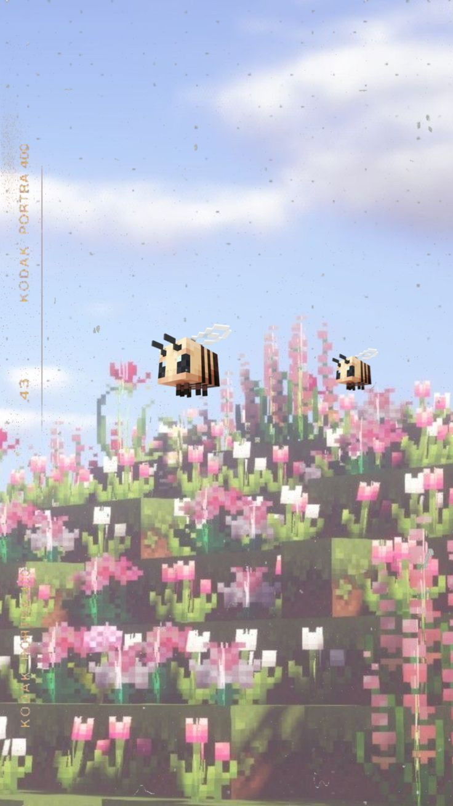

<!-- Animated greeting -->

 

<!-- Minecraft -->

<!-- About me -->
<h3>˗ˏˋ 🍒 ꒱ Hi, I'm Azaliya!</h3>

  Frontend enthusiast & Web Project Manager ♡
    
  I love creating beautiful, functional websites
   
  and turning creative ideas into reality.
    
  Exploring AI, automation & modern web technologies.

  <i>₊˚⊹♡ Always learning, creating & improving ♡⊹˚₊</i>

<!-- Decorative separator -->

୨୧ ───── ⋆ ˚｡⋆୨♡୧⋆ ˚｡⋆ ───── ୨୧

<!-- Kyubey -->

 

<!-- Languages & Tools -->
<h3>♡ Languages & Tools ♡</h3>

<b>✧ Frontend & Design ✧</b>

  

<b>✧ Backend & Development ✧</b>

  

<b>✧ CMS & Workflow ✧</b>

  

<!-- Additional CMS -->

  
  &nbsp;
  

<!-- Footer -->

  ⋆｡°✩ Made with curiosity, creativity & a little bit of magic ✩°｡⋆

